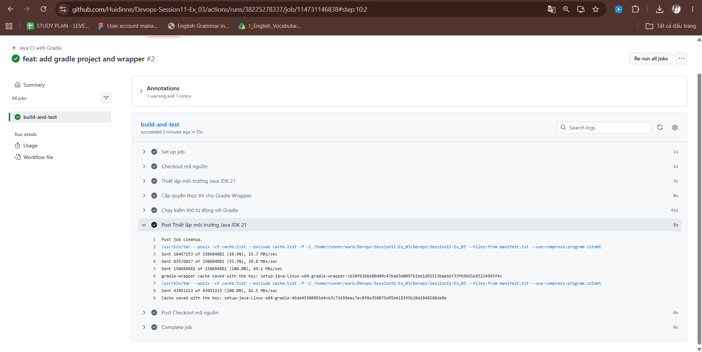
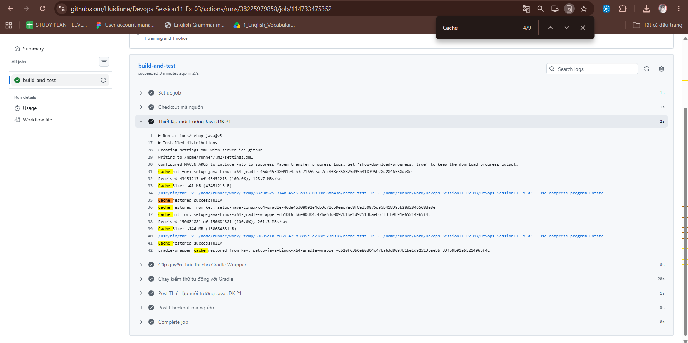
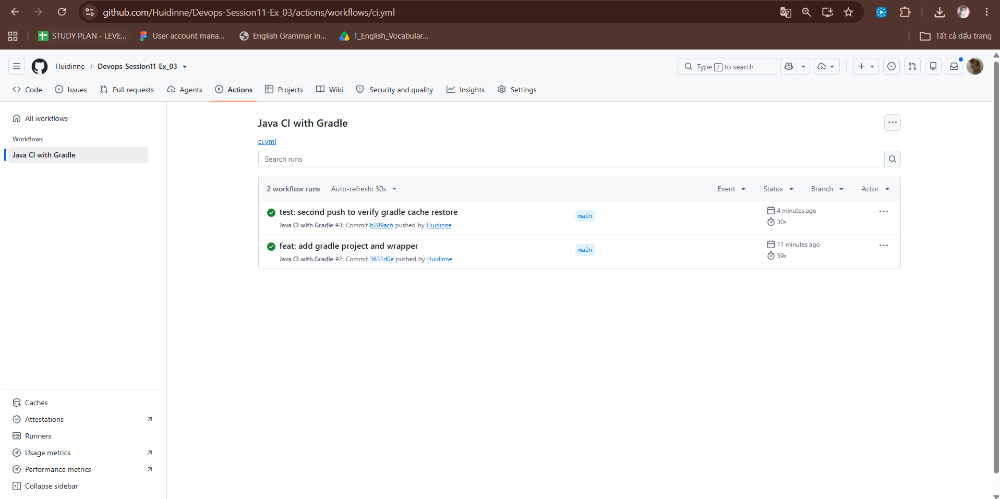

# Báo Cáo: Tối Ưu Tốc Độ CI Bằng Gradle Dependency Caching (Bài 3)

---

## 2. Mục Tiêu & Cơ Chế Thực Hiện
- **Mục tiêu**: Giảm thiểu thời gian tải các thư viện phụ thuộc (dependencies) từ Internet trong mỗi lần chạy luồng CI trên GitHub Actions.
- **Giải pháp**: Tích hợp tham số `cache: 'gradle'` vào action `actions/setup-java@v5`. Action này sẽ tự động hash các tệp quản lý dependency (`build.gradle`, `settings.gradle`) làm cache key để lưu trữ và tái sử dụng thư mục cache của Gradle (`~/.gradle/caches`).

---

## 3. Bảng So Sánh Thời Gian Thực Thi

| Tiêu chí                      | Lần chạy 1 (Chưa có Cache / Cache Miss) | Lần chạy 2 (Đã có Cache / Cache Hit) | Độ chênh lệch / Cải thiện |
|:------------------------------|:---------------------------------------:|:------------------------------------:|:-------------------------:|
| **Bước `actions/setup-java`** |       ~...s (Chưa tìm thấy cache)       |      ~...s (Đã khôi phục cache)      |            ...            |
| **Bước `./gradlew test`**     |  ~...s (Tải dependencies từ Internet)   |    ~...s (Lấy trực tiếp từ cache)    |        Giảm ~...%         |
| **Tổng thời gian Job**        |                  ~...s                  |                ~...s                 |      Nhanh hơn ~...s      |

---

## 4. Minh Chứng & Phân Tích Log

### 4.1. Lần chạy thứ 1 (Lần đầu push - Tạo cache)
- **Hiện tượng**:
  - Bước `Setup Java`: Không tìm thấy cache tương ứng (`Cache not found`).
  - Bước `./gradlew test`: Phải download toàn bộ dependencies từ Maven Central/Gradle Plugin Portal.
  - Bước `Post Setup Java`: Thực hiện nén và lưu cache lên kho lưu trữ của GitHub Actions (`Cache saved successfully`).
- *Ảnh chụp màn hình lần 1*:
  

### 4.2. Lần chạy thứ 2 (Lần push tiếp theo - Khôi phục cache)
- **Hiện tượng**:
  - Bước `Setup Java`: Khôi phục cache thành công với thông báo:
    ```text
    Received 200 of ... (100.0%)
    Cache restored successfully from key: gradle-...
    ```
  - Bước `./gradlew test`: Gradle bỏ qua bước download thư viện và đi thẳng vào biên dịch/chạy test, giúp tốc độ tăng rõ rệt.
- *Ảnh chụp màn hình lần 2*:



---

## 5. Kết Luận
- Việc bật `cache: 'gradle'` trong GitHub Actions giúp workflow CI tiết kiệm tài nguyên mạng, giảm thời gian phản hồi (feedback loop) cho lập trình viên và tối ưu số phút chạy (Action runner minutes).
